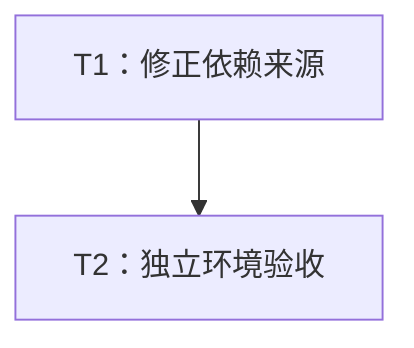

# RSMD-001 独立检出构建修复实施计划

> **面向执行者：** 按 T1 → T2 顺序实施，使用复选框记录结果。任务小且写入集合相关，在当前会话串行执行即可；不需要并行 agent 或新 Paseo workspace。

**目标：** 移除正常构建对兄弟源码目录的隐式依赖，恢复当前 crate 独立检出后的解析与 CI 能力。

**架构：** 保留现有依赖版本及 feature 契约，只删除四个外部 `path` 字段。同步必要锁文件变化，使用无兄弟目录、无本地覆盖的独立快照进行最终验证。

**技术栈：** Rust 1.94+、Cargo、现有 rs-infra CI、注册表版本依赖。

**设计依据：** [设计文档](design-20261030T071958072Z-eddf0b65.md)。本计划按用户指定路径保存，不使用技能默认的临时文档路径，也不设置额外方案审批步骤。

## 纳入范围与取舍

| 编号 | 优先级 | 采纳状态 | 实施任务 |
| --- | --- | --- | --- |
| RSMD-001 | P1 | 全部纳入：独立检出缺少路径依赖、CI 准备清单为空 | T1、T2 |

用户明确搁置或拒绝的条目：无；待验证疑点：无保留项。已撤回的 `Option` getter 属性候选不进入任务列表。不要追加架构、风格、rustdoc 或双语文档重构。

当前方案生成阶段在本计划与设计文档写完时结束。下列复选框均描述下一阶段实际实施与验证，并不禁止届时修改配置、更新锁文件或执行测试。是否提交或推送，依据下一阶段命令的实际授权，不预设需要提交，也不把当前阶段限制延续到下一阶段。

## 全局约束

- 使用当前 Paseo workspace，不创建或打开新的 Paseo workspace。
- CI 只验证当前 crate 自身，不加入或保留 downstream all-features 测试。
- 仅处理任务直接相关内容，采用最小改动，保留已有用户修改。
- 持续适用的删除、移动、提交规则以用户原文及实施阶段授权为准，不从旧方案推断额外授权。

## 文件与交付边界

| 文件 | 下一阶段用途 |
| --- | --- |
| Cargo.toml | 删除 qubit-datatype、qubit-json、qubit-redact、qubit-value 的四个外部 path 字段。 |
| Cargo.lock | 保留版本区间下同步注册表来源、校验信息及必要的解析变化。 |
| fuzz/Cargo.lock | 同步根依赖来源变化；保留用户已有暂存变更。 |

`.infra/ci/local-path-dependencies.tsv` 属于受管快照，本方案不修改它；不修改其摘要或引入新基础设施 profile。`fuzz/Cargo.toml` 到本仓库的 `path = ".."` 保持不变。生产源码、既有测试与文档不在实施写入集合内。

## 调度图

| 任务 | 前置任务 | 最小解锁产物 | 写入集合 | 本地验证 | 集成验证归属 | 审查时机 |
| --- | --- | --- | --- | --- | --- | --- |
| T1：修正依赖来源 | 无 | 四条版本依赖声明与必要锁文件变化，保留基线证据 | Cargo.toml、Cargo.lock、fuzz/Cargo.lock | 两个 manifest 解析及锁文件 diff；保存干净环境修复前错误 | T2 | 立即审查 |
| T2：独立环境验收 | T1 | T1 最终工作树文件快照，无需以提交解锁 | 仅隔离验收目录和证据；不改源码 | 两个 manifest 的 --locked 解析、注册表来源核对 | 本任务执行一次既有 CI | 立即审查 |

任务共用同一 Cargo 资源组，串行执行。T2 负责唯一一次完整 CI，不先重复手工运行全 feature 测试。隔离目录只是验收用可丢弃快照，不是新 Paseo workspace。

## 任务拓扑依赖图



## T1：修正依赖来源与锁文件

**输入：** 当前 rs-metadata 工作树，包括已有暂存内容。

**输出：** 仅四个 path 字段删除和必要的锁文件变化；供 T2 使用的最终工作树文件内容及修复前基线证据。

- [ ] 阅读实施时适用的项目指令与缺陷修复规则；如果执行 Git 状态变更操作，先读取 `~/.agents/specs/git.mdc`。当前修复不需要改 Rust 或 Shell 脚本，不为此扩读无关规范。
- [ ] 运行 `git status --short`、`git diff`、`git diff --cached`，保存已有变更边界和这三个目标文件的原内容。尤其保留 `fuzz/Cargo.lock` 的既有暂存修改，不使用 reset、restore 或整文件替换覆盖它。
- [ ] 在当前 workspace 内进行操作，在仓库外创建专用隔离验收目录并记录绝对路径。复制当前工作树中 tracked 及与构建相关的非忽略文件；排除 `.git`、target、缓存和本地 `.cargo/config*`。不以 HEAD 归档代替当前工作树，不复制兄弟仓库。确认快照父目录不存在四个 rs-* 目录；不修改或删除原 workspace 的目录。
- [ ] 在快照根执行 `cargo metadata --all-features --format-version 1`，记录预期的缺失兄弟目录 Cargo.toml 错误。若基线已经不再存在，先核对当前配置是否被其他工作修正，不按过期方案重复修改。
- [ ] 只读核实原版本区间内已发布的 qubit-datatype、qubit-json、qubit-redact、qubit-value 包及所需 feature。记录候选版本和来源；如果不存在或不兼容，报告具体阻塞，不自动升级版本区间、发布依赖或修改兄弟仓库。
- [ ] 将 Cargo.toml 的四条声明替换为以下内容，其他字段保持原样：

```toml
qubit-datatype = { version = "^0.15", default-features = false, features = ["converter"] }
qubit-json = { version = "^0.12", optional = true }
qubit-redact = { version = "^0.10", default-features = false }
qubit-value = { version = "^0.13", default-features = false, features = ["converter", "redact"] }
```

- [ ] 在根目录运行 `cargo metadata --all-features --format-version 1`，允许本次因来源变化产生的必要锁文件更新。审阅解析结果和 Cargo.lock，确认四个依赖来源为注册表，未通过用户全局 patch 偷换为本地源码。必要时在隔离配置环境解析，不修改用户全局 Cargo 配置。
- [ ] 运行 `cargo metadata --manifest-path fuzz/Cargo.toml --format-version 1` 同步 fuzz/Cargo.lock。只允许本项目路径仍指向 `..`，四个外部包使用注册表来源。不要执行无差别 `cargo update`，也不要手工添加 checksum。
- [ ] 运行 `git diff --check`，审阅 Cargo.toml 及两个锁文件的暂存/未暂存差异；记录版本、source、checksum 和必要传递依赖变化。检查对既有用户修改没有覆盖。若某锁文件无变化则不强制造成变更。

**完成条件：** 保持原依赖契约，注册表可解析，锁文件差异有解释。T1 尚不代表 CI 已通过；无需提交即可把最终工作树内容交给 T2。

## T2：独立环境验收与最终审查

**输入：** T1 最终工作树及两个锁文件。

**输出：** 无兄弟目录环境下的锁定依赖解析结果、当前 crate 既有 CI 结果及最终变更审查结论。

- [ ] 使用 T1 相同规则重新制作最终文件快照。验收目录不得包含修复前生成的本地补丁或临时锁文件，不复用未经核对的旧快照。再次确认不存在兄弟目录，也没有作用于该快照的本地 path patch、Cargo source 替换或 RUSTFLAGS 依赖注入；如需隔离 CARGO_HOME，可复用已核对的缓存，但不得把用户覆盖配置一起带入。
- [ ] 在快照根依次运行以下命令并保存完整输出、退出码和环境说明：

```text
cargo metadata --locked --all-features --format-version 1
cargo metadata --locked --manifest-path fuzz/Cargo.toml --format-version 1
```

预期两者退出码为 0。检查 metadata 的 packages：四个包 source 为注册表，manifest_path 不指向 rs-* 兄弟目录；fuzz 对当前项目的内部路径允许保留。`--locked` 不得要求再更新锁文件。

- [ ] 在该快照运行一次 `./.infra/bin/ci-check.sh`，由项目既有配置执行当前 crate 的验证、feature 矩阵、Clippy、文档和 fuzz 等检查。允许准备构建所需工具与产物；不加入或运行 downstream all-features 测试。不要先手工重复其完整矩阵。记录工具版本、最终状态和失败分类；环境/网络失败不能当作成功，相关失败修正后仅重跑受影响检查及必要最终门禁。
- [ ] 回到原工作树进行只读 diff 审查，确认本项修改局限于 Cargo.toml 和必要锁文件变化，没有修改 `.infra` 受管文件、生产源码或用户其他内容。
- [ ] 给出 RSMD-001 的最终验收结论，附修复前错误、修复后 metadata 来源和 CI 证据。若现有 CI 发现无关问题，单独记录，不扩大本项修复，也不把它们掩盖为通过。

**完成条件：** 无兄弟目录及本地覆盖仍可锁定解析，当前 crate 的既有 CI 成功，变更范围准确且用户工作保留。发布包、修改下游及破坏性 API 迁移均不是本计划任务。

## 失败处理与回退

已发布版本不可用或接口不符时，保留具体依赖和报错，停止当前路径，重新提出仍限于 RSMD-001 的替代方案。不要为绿色检查临时创建兄弟目录或偷偷加 patch。回退仅恢复本次实施产生的变更，先对照实施前保存的文件状态，避免丢弃用户原有修改。

可丢弃验收目录的清理由实施阶段适用规则决定；确认只含本次生成的快照、缓存及产物后处理，不删除源码仓库、用户配置或未保存工作。

## 需求与任务对应、自检

| 设计要求 | 对应任务 |
| --- | --- |
| 仅纳入 RSMD-001，采用最小改动 | T1 |
| 保留版本、feature、optional 和 MSRV 契约 | T1 |
| 不触碰受管清单或伪造快照摘要 | T1、T2 |
| 两份锁文件适配注册表依赖 | T1、T2 |
| 保留已有用户修改 | T1、T2 |
| 独立检出无兄弟目录、无本地覆盖 | T1 基线、T2 最终验收 |
| 验证当前 crate，不增加下游测试 | T2 |
| 已发布候选不兼容时不扩大修改范围 | T1、失败处理 |

调度表、拓扑图和任务列表均仅含 T1、T2。各任务前置条件、写入集合、成功条件与失败处理已明确；文档未执行或声称完成上述实施验证。
