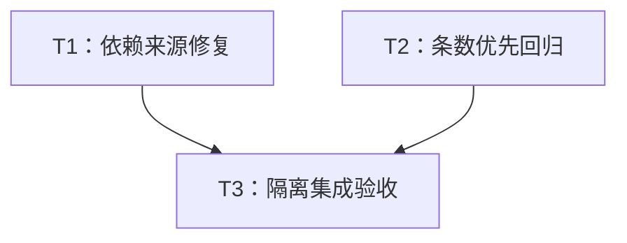

# rs-metadata 独立构建与限额回归实施计划

> **面向执行者：** 使用 executing-plans 按 T1、T2、T3 的依赖关系执行，以复选框记录结果。任务小，单执行者即可完成；无需并行 agent 或新 Paseo workspace。

**目标：** 完成 RSMD-001 独立检出构建修复和 RSMD-002 领域条目解码顺序回归。

**架构：** 保留公开 API 与 wire 合同，删除四个外部依赖 path，只在既有公开测试目标增加两个回归。生产实现当前无需调整。

**技术栈：** Rust 1.94+、Cargo、Serde、现有 rs-infra CI。

**设计依据：** [本轮设计](design-20261030T091723393Z-696071c7.md)。用户指定本文件路径，优先于技能默认临时目录；不创建技能临时 workspace、不设置额外方案审批。

## 纳入条目与范围

| 编号 | 状态 | 实施任务 |
| --- | --- | --- |
| RSMD-001 / P1 | 全部纳入，确认构建配置问题 | T1、T3 |
| RSMD-002 / P2 | 全部纳入，确认测试缺口；不认定当前实现缺陷 | T2、T3 |

用户明确搁置或拒绝的条目及原因：无。无保留待验证疑点。已撤回属性候选、一般风格小项、旧覆盖率产物不纳入。

当前方案生成阶段只写两份指定文档并在完成后结束。下列任务属于下一阶段，可按实施命令修改文件、同步锁文件和执行测试；提交、推送根据实施时的实际授权决定，本计划不将提交设为任务依赖。

## 全局约束与基线

- 使用当前 Paseo workspace，不创建或打开新的 Paseo workspace。
- CI 只验证当前 crate，不加入或保留 downstream all-features 测试。
- 只改任务直接相关内容，不顺手重构、格式化或清理。
- 保留已有暂存和未暂存修改；不 reset、stash、整文件 restore 或覆盖用户内容。
- 不自动删除、移动重要文件；可丢弃产物清理遵循用户既有规则。
- 不把旧方案中的断言当作已执行证据；实施前核对实际工作树和依赖发布状态。

实施开始先读取适用的缺陷修复规则；修改 Rust 测试前读取 ~/.agents/specs/rust-test.mdc 及适用 Rust 风格规则。若要编写 Shell 脚本或执行高风险 Shell 命令，读取 shell.mdc；若要改变 Git 或远端状态，读取 git.mdc。本计划不要求为读取状态而执行 Git 写操作。

## 文件职责

| 文件 | 预期变化 |
| --- | --- |
| Cargo.toml | 只删除四个外部 path 字段。 |
| Cargo.lock | 同步注册表来源及必要解算变化。 |
| fuzz/Cargo.lock | 同步外部依赖来源，保留已有暂存内容。 |
| tests/metadata_wire_limits_tests.rs | 增加 metadata、schema 两个公开入口回归及需要的显式 import。 |

不修改 .infra 受管快照、CI 矩阵、兄弟仓库、公开 API 或生产源码。若新增测试暴露超出已知范围的真实问题，先记录原因和最小处理方向，再按实施阶段授权判断，不顺带扩大修复。

## 调度图

| 任务 | 前置任务 | 最小解锁产物 | 写入集合 | 本地验证 | 集成验证归属 | 审查时机 |
| --- | --- | --- | --- | --- | --- | --- |
| T1：依赖来源修复 | 无；与 T2 编辑独立，同属 A 批 | 四条版本依赖及必要锁文件变化，无需提交 | Cargo.toml、Cargo.lock、fuzz/Cargo.lock；隔离基线证据 | 两 manifest metadata 与来源、lock diff | T3 | 立即审查 |
| T2：条数优先回归 | 无；与 T1 编辑独立，同属 A 批 | 两个完整测试函数，无需提交 | tests/metadata_wire_limits_tests.rs | 两种最小 feature 的聚焦测试 | T3 | 立即审查 |
| T3：隔离集成验收 | T1、T2 | 最终工作树文件快照 | 验收目录、日志及可重新生成产物 | 隔离 --locked 解析、最终 diff | 唯一一次完整 CI | 立即审查 |

T1、T2 写入集合独立，逻辑上允许并行编辑；本次规模采用单执行者即可。Cargo 重型命令属于同一资源组，串行运行，尤其锁文件解析不得与使用相同 target 的测试竞争。若单执行者按 T1→T2 执行，这是资源调度选择，不是人为添加实现依赖。

## 任务拓扑依赖图



## T1：依赖来源修复

**输入：** 当前工作树，包括用户已有暂存内容。**输出：** 四条无外部 path 的依赖与必要锁文件更新，以及修复前解析基线。

- [ ] 读取 git status --short、git diff、git diff --cached，保存四个目标文件的基线内容和差异。尤其确认 fuzz/Cargo.lock 已有暂存变化；已有旧 doc 文件和 staged 生产改动均保留。
- [ ] 在当前 workspace 内、仓库外建立专用验收目录，不注册 Paseo workspace。按 tracked 和非忽略 untracked 清单复制当前构建输入，排除 .git、target、缓存与本地 .cargo/config*。核对没有四个兄弟目录，也没有生效的 path patch/source 替换。不能用 git archive HEAD 丢弃当前修改。
- [ ] 在修复前快照执行 cargo metadata --all-features --format-version 1，保存缺失兄弟 Cargo.toml 的预期失败。若基线已消失，检查是否被其他工作修复，不重复编辑旧配置。
- [ ] 核实原版本范围内已发布依赖及 feature；替换 Cargo.toml 的四条声明为：

```toml
qubit-datatype = { version = "^0.15", default-features = false, features = ["converter"] }
qubit-json = { version = "^0.12", optional = true }
qubit-redact = { version = "^0.10", default-features = false }
qubit-value = { version = "^0.13", default-features = false, features = ["converter", "redact"] }
```

- [ ] 在来源已核实且无覆盖的环境执行下列解析，同步锁文件；预期退出 0，四个包 source 为 registry，其他版本尽量保持。若宿主环境有本地覆盖，使用受控快照解析后逐项合并必要 lock 变化，不将覆盖带回原项目。

```text
cargo metadata --all-features --format-version 1
cargo metadata --manifest-path fuzz/Cargo.toml --format-version 1
```

- [ ] 审查两个 lock diff 的版本、source、checksum 和传递变化；不手写 checksum、不做无差别升级、不修改 fuzz/Cargo.toml 中的仓库内部路径。

**完成条件：** 两个 manifest 正常解析，四个外部依赖来源正确，原版本/feature 契约保留。此时尚不声称独立 CI 已通过。

## T2：增加领域条数提前拒绝回归

**输入：** 当前公共 API 和已有测试目标。**输出：** 以下两个测试函数，无生产代码改动。

- [ ] 在 tests/metadata_wire_limits_tests.rs 顶部外部依赖组增加显式 `use serde_json::json;`、`use serde_json::to_value;`；先确认没有重复 import。
- [ ] 在现有 metadata 条数测试附近加入：

```rust
#[test]
fn test_metadata_entry_limit_precedes_overflow_value_decoding() {
    let metadata = Metadata::new().with("first", 1_i64);
    let limits = MetadataLimits::builder().max_metadata_entries(1).build().unwrap();
    let input = serde_json::to_vec(&metadata).unwrap();
    let decoded = Metadata::decode_json_slice_with_limits(&input, limits)
        .expect("one entry must fit the exact domain limit");
    assert_eq!(decoded, metadata, "the valid baseline must round-trip");

    let mut document = to_value(&metadata).unwrap();
    document["values"]["zz_overflow"] = json!(null);
    let input = serde_json::to_vec(&document).unwrap();
    let error = Metadata::decode_json_slice_with_limits(&input, limits)
        .expect_err("the second entry must be rejected before its value is decoded");
    assert!(matches!(
        error,
        MetadataWireDecodeError::Domain(MetadataError::WireLimitExceeded {
            kind: MetadataWireLimitKind::Entries,
            value: 2,
            maximum: 1,
        })
    ), "the entry count must take precedence over the invalid value: {error:?}");

    let limits = MetadataLimits::builder().max_metadata_entries(2).build().unwrap();
    let error = Metadata::decode_json_slice_with_limits(&input, limits)
        .expect_err("null must be an invalid metadata wire value when admitted");
    assert!(!matches!(
        error,
        MetadataWireDecodeError::Domain(MetadataError::WireLimitExceeded {
            kind: MetadataWireLimitKind::Entries, ..
        })
    ), "the control must fail on the admitted value rather than the entry count: {error:?}");
}
```

- [ ] 在现有 schema 条数测试附近加入：

```rust
#[cfg(feature = "schema")]
#[test]
fn test_schema_entry_limit_precedes_overflow_field_decoding() {
    let schema = MetadataSchema::builder()
        .required("first", DataType::Int64)
        .build()
        .unwrap();
    let limits = MetadataLimits::builder().max_schema_fields(1).build().unwrap();
    let input = serde_json::to_vec(&schema).unwrap();
    let decoded = MetadataSchema::decode_json_slice_with_limits(&input, limits)
        .expect("one schema field must fit the exact domain limit");
    assert_eq!(decoded, schema, "the valid baseline must round-trip");

    let mut document = to_value(&schema).unwrap();
    document["fields"]["zz_overflow"] = json!(null);
    let input = serde_json::to_vec(&document).unwrap();
    let error = MetadataSchema::decode_json_slice_with_limits(&input, limits)
        .expect_err("the second field must be rejected before its definition is decoded");
    assert!(matches!(
        error,
        MetadataWireDecodeError::Domain(MetadataError::WireLimitExceeded {
            kind: MetadataWireLimitKind::Entries,
            value: 2,
            maximum: 1,
        })
    ), "the field count must take precedence over the invalid definition: {error:?}");

    let limits = MetadataLimits::builder().max_schema_fields(2).build().unwrap();
    let error = MetadataSchema::decode_json_slice_with_limits(&input, limits)
        .expect_err("null must be an invalid field definition when admitted");
    assert!(!matches!(
        error,
        MetadataWireDecodeError::Domain(MetadataError::WireLimitExceeded {
            kind: MetadataWireLimitKind::Entries, ..
        })
    ), "the control must fail on the admitted definition rather than the field count: {error:?}");
}
```

使用现有 serde_json::to_vec 调用风格，不机械修改原文件其他引用；格式按项目规则整理本次新增部分。输入 key 选择 first、zz_overflow 保证有序 JSON 对象中合法项先到达。不要使用畸形 JSON 文本，它会被共享 JSON parser 提前拒绝而无法观察领域检查顺序。

- [ ] 串行运行两个最小 feature 配置，预期分别执行 1 和 2 个匹配测试且全部通过，无过滤为空的“成功”。

```text
cargo test --locked --no-default-features --features json --test metadata_wire_limits_tests entry_limit_precedes_overflow
cargo test --locked --no-default-features --features json,schema --test metadata_wire_limits_tests entry_limit_precedes_overflow
```

现有实现正确，回归直接通过是预期；不制造生产缺陷作为红灯。失败时记录实际错误并定位，不按预期结果改弱断言。若发布依赖暴露问题，先按 T1 的依赖来源核查，不以宿主本地 patch 掩盖。

**完成条件：** 精确边界接受、超限错误优先、放宽限额后非法领域值仍拒绝三种观察同时成立。此测试不证明共享 JSON 源树没有被解析或分配。

## T3：最终隔离集成验收

**输入：** T1、T2 最终文件内容，无需提交。**输出：** 完整来源、测试与当前 crate CI 证据，以及原有修改保留结论。

- [ ] 检查最终本次 diff；需要运行项目 alignment 时先确认并保存已有用户差异，在验收副本中运行并检查变化，仅合入本任务直接相关整理，不回写无关格式变化。确认随后验证的是最终稳定内容。
- [ ] 从最终工作树重新制作无兄弟目录的受控快照，不复用修复前产生的临时解析结果或本地覆盖；根和 fuzz 锁文件与最终内容一致。
- [ ] 在最终快照执行下面两个命令，预期退出 0，不要求更新 lock。检查 packages 的四个依赖 source 是 registry，manifest_path 不指向兄弟源码；fuzz 对本项目的 path = ".." 保留。

```text
cargo metadata --locked --all-features --format-version 1
cargo metadata --locked --manifest-path fuzz/Cargo.toml --format-version 1
```

- [ ] 在同一快照执行一次既有完整 CI，统一负责矩阵、Clippy、文档、fuzz、覆盖率等已配置检查。不预先重复完整矩阵，不新增 downstream all-features。

```text
./.infra/bin/ci-check.sh
```

- [ ] 若 alignment 或后续修复改变被验收内容，重新检查差异并仅补跑受影响验证及必要最终门禁；缺工具、网络失败、测试失败分别记录，不用日志缺失代表通过。
- [ ] 原工作树执行 git diff --check，并同时审查暂存和未暂存差异，确认本次变化限于文件职责表，已有 staged 生产改动和 doc 文件保留。汇报两项的证据、命令、退出码与任何未完成项。

**完成条件：** 无兄弟目录或本地覆盖仍能 --locked 解析；新增两测试及当前 crate 既有 CI 通过；本次差异范围可解释、原有用户内容完整保留。提交或发布不是本计划的验收替代物，也不由此获得授权。

## 失败处理

注册表依赖缺失或不兼容时，保留版本与具体错误，停止依赖该结果的验收，不擅自扩大版本升级范围。测试暴露新问题时说明是数据、解码合同还是依赖差异。任何回退仅处理本次改动，不能回滚用户已有修改。验收目录的预期清理只处理已确认可丢弃的产物，不能删除仓库或用户数据。

## 需求映射与自检

| 必须项 | 任务 |
| --- | --- |
| RSMD-001 最小配置修复、保留版本及 feature | T1 |
| 原有 staged 内容保留、必要锁文件同步 | T1、T3 |
| RSMD-002 两种领域的公开入口优先级回归 | T2 |
| 精确边界和非法值控制，避免 JSON 语法预检干扰 | T2 |
| 无兄弟目录、无 path patch、--locked 来源核对 | T1 基线、T3 最终 |
| 一次当前 crate 全量集成验证，无 downstream 测试 | T3 |
| 最终差异检查、失败分类及范围控制 | T3 |

调度表、拓扑图、任务正文均只有 T1、T2、T3。两项评审均有实现任务及验收归属；没有新增 API、风格清理、双语文档重写或新基础设施任务。
